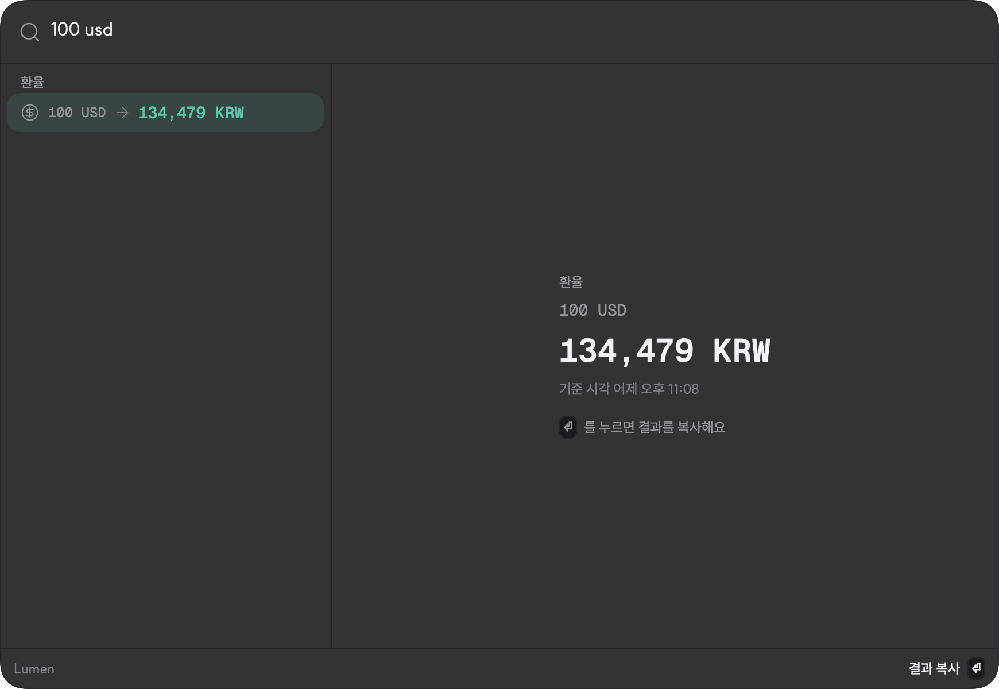
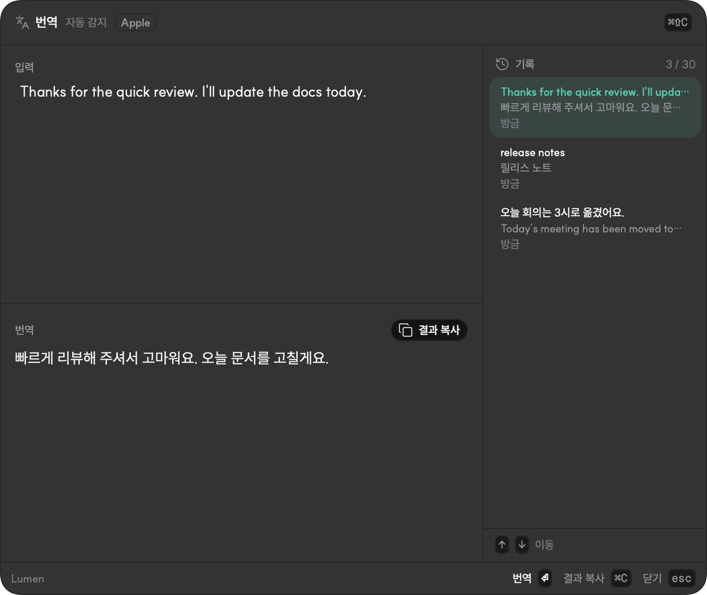
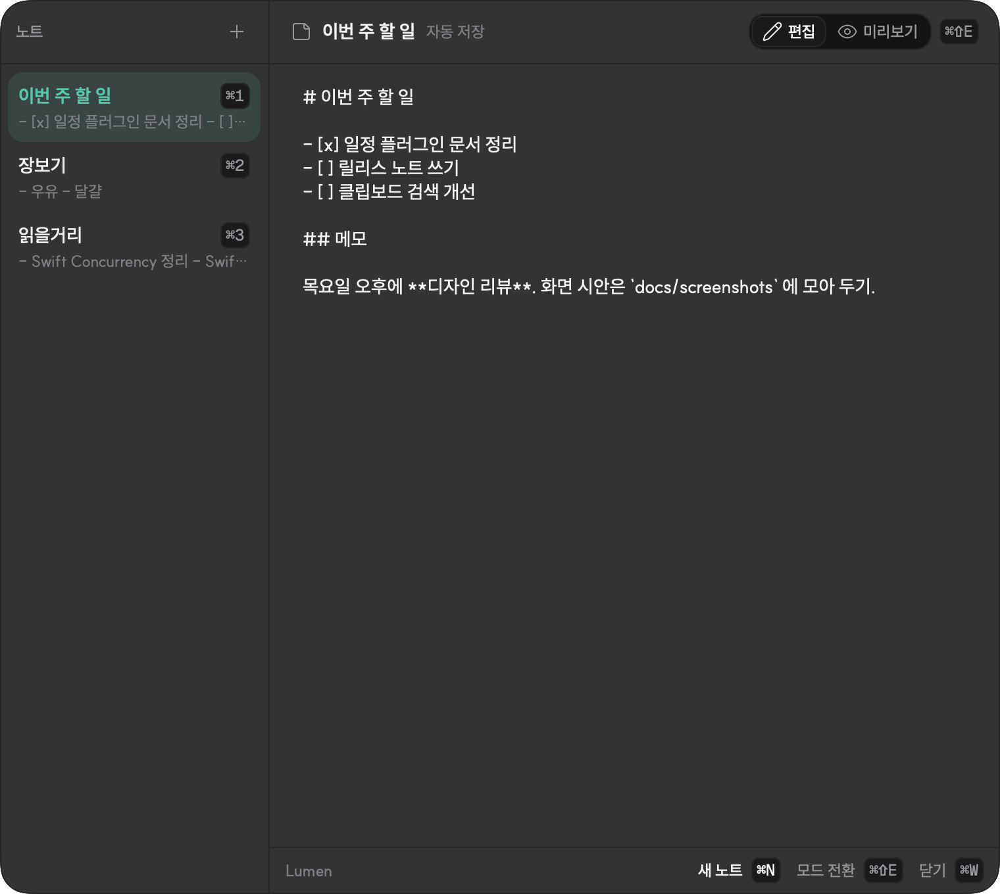
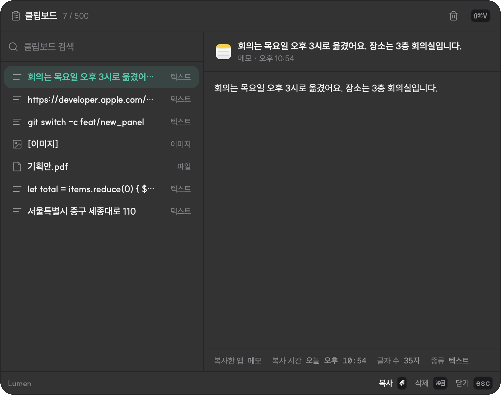
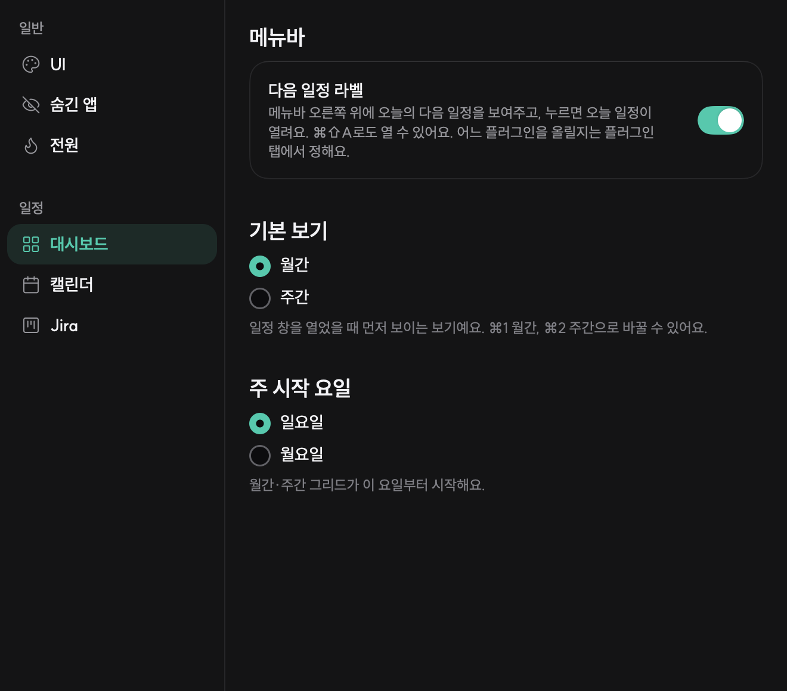
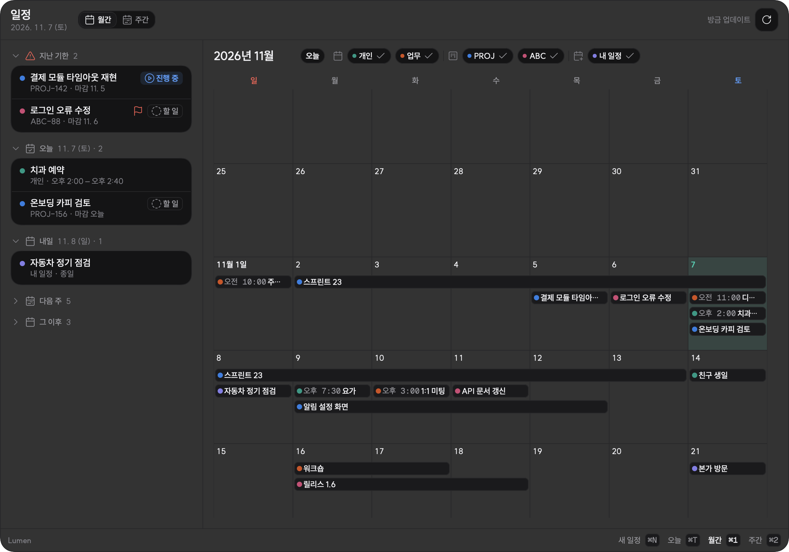

# Lumen

> 메뉴바에서 시작해 메뉴바에서 끝나는, macOS용 개인 런처 + 유틸리티 모음.

[](https://github.com/Hwan3434/Lumen/releases/latest)


Lumen은 **⌘Space**로 떠오르는 패널에서 앱 실행 · 계산 · 환율 변환 · 번역 · 클립보드 · 메모 · 일정을 처리합니다. 작업의 맥락을 끊지 않는 게 핵심 — 패널을 띄우고, 일을 마치고, 사라집니다.

---

## ✨ 화면

*스크린샷은 모두 예시 데이터로 그렸습니다.*

### 검색 — `⌘Space`



설치된 앱 빠른 실행, 사칙연산(`5 * (3+2)`), 환율 변환(`100 usd`, `5만원`). 아래 [그 밖의 기능](#그-밖의-기능)도 이름으로 찾아 켭니다. 검색 결과에 호버하면 나오는 숨기기 버튼으로 앱을 목록에서 뺄 수 있어요.

### 번역 — `⌘⇧C`



Apple 온디바이스 번역(`Translation` 프레임워크) 기반 한↔영 번역. API 키도 네트워크도 필요 없고, 입력 언어를 자동 감지해 반대 방향으로 번역합니다. 오른쪽에 최근 번역 30건 기록, `⌘C`로 결과 복사.

### 노트 — `⌘⇧X`



마크다운 메모. 왼쪽 사이드바로 노트 여러 개를 탭처럼 관리합니다. `⌘N` 새 노트, `⌘1`~`⌘9` 탭 이동, `⌘⇧]/[` 다음·이전, `⌘⌫` 삭제, `⌘⇧E` 편집/미리보기 전환, `⌘W` 닫기. 입력은 1초 뒤 자동 저장.

### 클립보드 — `⌘⇧V`



최근 텍스트 · 이미지 · 파일 기록 500건. 왼쪽에서 항목을 고르면 오른쪽에 본문과 복사한 앱 · 시간 · 글자 수가 보이고, `↩`로 바로 복사합니다.

### 설정 — `⌘,`



사이드바가 **일반**(UI, 숨긴 앱, 전원)과 **일정**(대시보드, 캘린더, Jira)으로 나뉩니다. UI 탭에서 테마(시스템 · 다크 · 라이트), 밀도, 배경 유리 효과를 고릅니다. 일정 플러그인 설정은 저장하면 바로 적용되고, 숨긴 앱은 **숨긴 앱** 탭에서 한 번에 되돌립니다.

### 일정 — `⌘⇧G`



캘린더 앱의 일정, Jira 담당 이슈, 직접 적은 내 일정을 한 화면에 모읍니다. 연동이 없어도 열리고, 일정 출처는 플러그인으로 붙습니다(새 출처 붙이는 법: [docs/schedule-plugins.md](docs/schedule-plugins.md)). 왼쪽은 지난 기한부터 그 이후까지 날짜로 묶은 목록, 오른쪽은 월간 · 주간 캘린더예요. 토 · 일요일과 공휴일은 빨간색이고, 음력 날짜를 함께 볼 수 있어요. 패널 안에서 `⌘1` 월간, `⌘2` 주간, `⌘T` 오늘, `⌘N` 새 일정. 메뉴바에는 다음 일정 라벨이 뜨고, 누르거나 `⌘⇧A`를 누르면 오늘 일정이 열려요.

---

## 그 밖의 기능

검색창에서 이름으로 찾아 실행합니다.

| 기능 | 하는 일 |
|---|---|
| 카페인 | 화면이 잠들지 않게 합니다. 앱을 켜면 자동으로 켜지고, 메뉴바 아이콘을 눌러 끕니다 |
| 클램쉘 모드 | 덮개를 닫아도 맥이 잠들지 않게 합니다. 전원이 연결된 동안은 계속 켜져 있고, 전원을 뽑으면 정한 시간(1·2·4·8시간) 뒤 자동으로 꺼져요 (처음 한 번 관리자 암호) |
| 윈도우 마그넷 | 앞에 있는 창을 화면 왼쪽·오른쪽에 붙입니다. 같은 방향을 다시 누를 때마다 너비가 20 → 40 → 60 → 80 → 100%로 바뀝니다. `⌃⌥←` / `⌃⌥→` |
| 컬러 피커 | 화면에서 색을 집어 HEX 값을 복사합니다 |
| 리소스 모니터 | Lumen 자신의 메모리 · CPU · 스레드를 실시간으로 봅니다. 진단용 추적 로그도 여기서 켜요 |

---

## 핫키

| 핫키 | 동작 |
|---|---|
| `⌘Space` | 검색 패널 |
| `⌘⇧C` | 번역 |
| `⌘⇧V` | 클립보드 |
| `⌘⇧X` | 노트 (다른 패널과 함께 띄울 수 있음) |
| `⌘⇧G` | 일정 대시보드 |
| `⌘⇧A` | 오늘 일정 (메뉴바) |
| `⌘⇧L` | 떠 있는 Lumen 패널로 키보드 포커스 되돌리기 |
| `⌃⌥←` / `⌃⌥→` | 윈도우 마그넷 왼쪽 / 오른쪽 (누를 때마다 너비 20~100%) |
| `⌘,` | 설정 |

패널은 한 번에 하나만 떠 있습니다. 다른 패널을 열면 앞의 패널이 닫혀요. 노트만 예외로 다른 패널과 나란히 띄울 수 있어요.

---

## ⚡ 빠른 시작 (사람용)

1. [최신 릴리즈](https://github.com/Hwan3434/Lumen/releases/latest)에서 `Lumen-x.y.z.zip` 다운로드
2. 압축 풀고 `Lumen.app`을 홈 폴더의 `~/Applications`로 이동 (폴더가 없으면 만들기. 자동 업데이트가 관리자 암호 없이 앱을 바꿀 수 있는 위치예요)
3. **첫 실행만** Finder에서 우클릭 → **열기** (self-signed 빌드라 Gatekeeper 통과 1회 필요)
4. 시스템 설정 → **손쉬운 사용**에서 Lumen 토글 ON (윈도우 마그넷이 다른 앱의 창을 옮길 때 필요)
5. `⌘,` 로 설정을 열어 **일정** 섹션에서 캘린더 · Jira 연동 켜기 (일정 대시보드에 연동 일정을 보고 싶을 때만)

이후 새 버전은 Sparkle이 1시간마다 확인해 자동으로 받습니다. 메뉴바 → "업데이트 확인…"으로 바로 확인할 수도 있어요.

---

## 외부 의존성

**필수: 없음.** macOS 표준 프레임워크만으로 동작합니다.

기능별 선택 의존:

| 기능 | 필요한 것 |
|---|---|
| 검색 / 클립보드 / 노트 / 윈도우 마그넷 / 카페인 / 컬러 피커 / 리소스 모니터 | 없음 |
| 환율 변환 | 인터넷 (open.er-api.com 하루 1회 받고 캐시로 오프라인 동작) |
| 번역 | 없음 (Apple 온디바이스 번역 — 첫 사용 시 macOS가 언어 모델 다운로드를 물어봅니다) |
| 클램쉘 모드 | 처음 한 번 관리자 암호 (시스템 잠자기 설정을 바꾸는 규칙을 설치) |
| 일정 대시보드 | 없음. 캘린더 연동은 캘린더 접근 권한, Jira 연동은 Jira Cloud 워크스페이스 + 이메일 + API 토큰 |

---

## 🤖 AI 에이전트용 자동 설치 / 트러블슈팅

AI 에이전트가 새 macOS에 Lumen을 자율 설치하기 위한 명령어 · 검증 단계 + 흔한 문제 해결법은 별도 문서로 분리했습니다 → **[docs/agent-install.md](docs/agent-install.md)**

---

## 🛠️ 빌드 & 배포

```sh
./scripts/release.sh 1.2.3   # archive → zip → EdDSA 서명 → appcast → GitHub Release
```

깨끗한 작업 트리에서, GitHub `main`과 같은 커밋으로만 돌아갑니다. 필요한 준비물과 단계는 [docs/release.md](docs/release.md)에 있어요.

README 스크린샷은 예시 데이터로 다시 그립니다 (실제 앱 화면을 찍으면 클립보드 · 노트 · 설정 값이 그대로 찍힙니다):

```sh
TEST_RUNNER_LUMEN_SNAPSHOT_DIR=/tmp/lumen-shots TEST_RUNNER_LUMEN_SNAPSHOT_DENSITY=cozy xcodebuild test -project Lumen/Lumen.xcodeproj -scheme Lumen \
  -destination 'platform=macOS' -only-testing:LumenTests/ReadmeScreenshotTests \
  -only-testing:LumenTests/ScheduleSnapshotTests/testRenderDashboardMonthAndWeek
```

`/tmp/lumen-shots` 의 PNG를 `docs/screenshots/` 로 옮깁니다(`schedule-month.png` → `Schedule.png`).

---

## 데이터 위치

모두 `~/Library/Application Support/Lumen/` 아래에 있습니다.

- **자격증명**: `secrets.dat` (기기 UUID로 난독화, 0600)
- **노트**: `notes/<id>.md` (탭마다 1파일)
- **클립보드 기록**: `clipboard_history.json`, 이미지는 `images/`
- **번역 기록**: `translation_history.json`
- **내 일정**: `local_events.json`
- **일정 캐시 / 숨긴 앱 / 환율 캐시 / 리소스 이상 기록**: `schedule_cache/`, `hidden_apps.json`, `currency_rates.json`, `resource_anomalies.json`
- **진단 로그**: `~/Library/Logs/Lumen/memory_trace.log`

---

## 스택

Swift · SwiftUI · AppKit · Carbon HotKey · Sparkle 2.x · NetworkImage · swift-markdown-ui. 배포 타깃 macOS 26.2.
